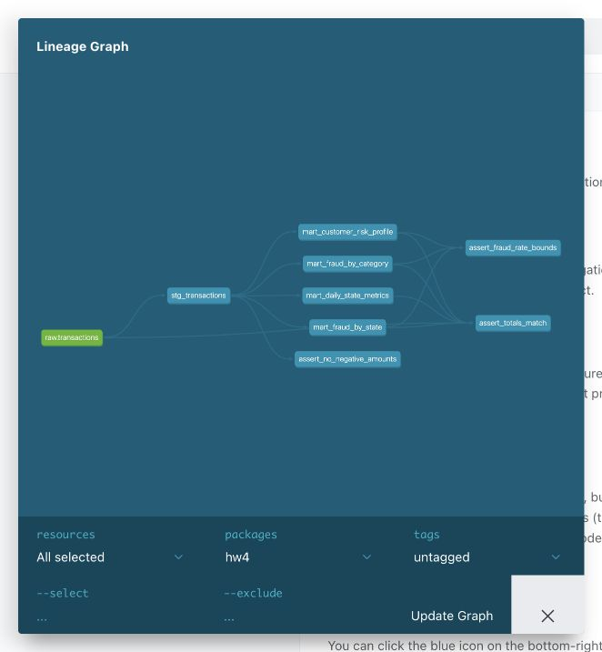

## запуск

данные лежат в `data/teta-ml-1-2025.zip`

```bash
python3.12 -m venv .venv
source .venv/bin/activate
pip install -r requirements.txt
docker compose up -d --wait
python scripts/load_data.py
cd dbt
dbt deps --profiles-dir .
dbt build --profiles-dir .
```

документация:

```bash
dbt docs generate --profiles-dir .
dbt docs serve --profiles-dir . --port 8084
```

открыть http://localhost:8084.

## результаты

- `mart_daily_state_metrics` — метрики по дням и штатам
- `mart_fraud_by_category` — фрод по категориям
- `mart_fraud_by_state` — фрод по штатам
- `mart_customer_risk_profile` — риск клиентов

есть макрос `amount_bucket`, пакеты `dbt_utils`, `dbt_date`, `dbt_expectations`, описания моделей и тесты. проверяются пустые значения, уникальность ключей, допустимые значения, отрицательные суммы, границы fraud_rate и совпадение итогов с исходными данными

id клиента в данных нет, поэтому он считается из имени, фамилии, адреса и координат. крупная покупка — от 1000. риск HIGH — от 5% фрода, MEDIUM — от 1%, иначе LOW.

dbt-core 1.9.8, dbt-clickhouse 1.9.6.

проверено на 786431 строке, все 61 тест прошли. логи и архив документации лежат в `results`.


